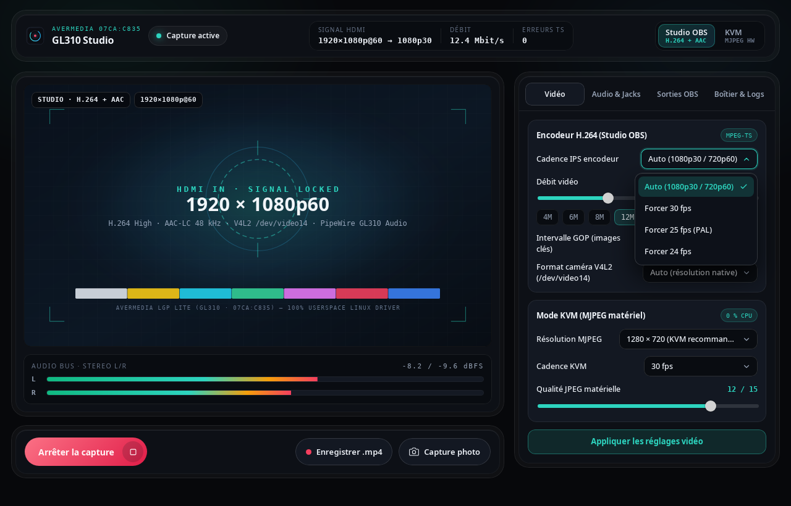
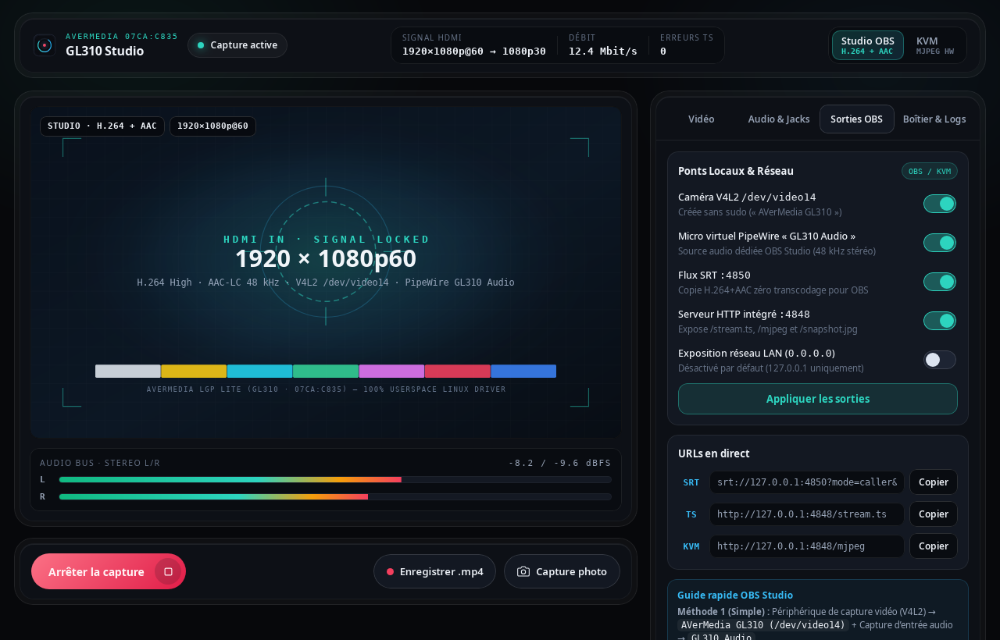
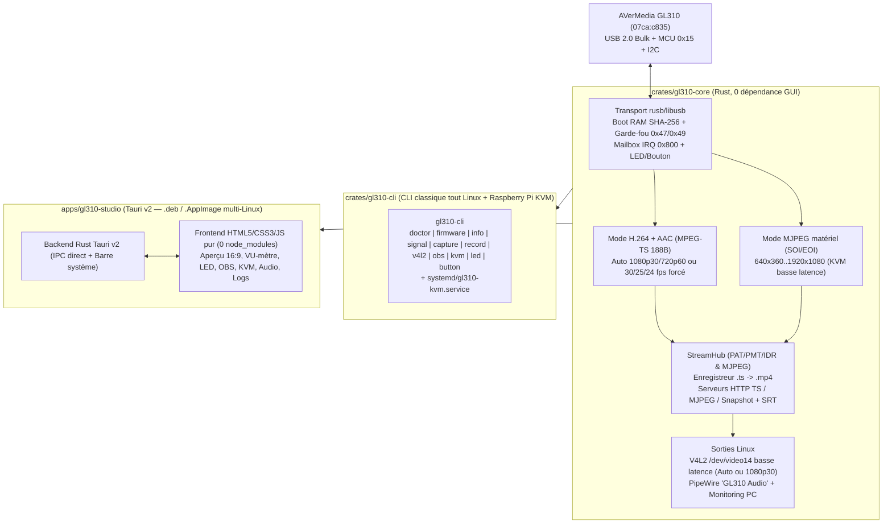

<div align="center">

# GL310-Linux

**Pilote Linux 100 % Espace Utilisateur, CLI Universelle, Daemon KVM Raspberry Pi & Application Desktop Tauri v2 pour l’AVerMedia Live Gamer Portable Lite (GL310, USB `07ca:c835`)**

[🇬🇧 English](README.md) | 🇫🇷 **Français**

[](LICENSE)
[](Cargo.toml)
[-f43f5e.svg)](apps/gl310-studio)
[-10b981.svg)](#mode-kvm-raspberry-pi)
[-6366f1.svg)](https://github.com/valoche-68/GL310-Linux/releases/latest)

</div>

---

## Aperçu de GL310 Studio

<p align="center">
  
</p>
<p align="center">
  <em>GL310 Studio — Moniteur 16:9 en direct, VU-mètre stéréo L/R temps réel, télémétrie HDMI et contrôles d’encodeur sombres</em>
</p>

<p align="center">
  
</p>
<p align="center">
  <em>Sorties OBS &amp; Réseau — Caméra V4L2 <code>/dev/video14</code>, micro PipeWire <code>GL310 Audio</code>, SRT <code>:4850</code>, HTTP <code>:4848</code> et URLs prêtes à copier</em>
</p>

---

## Présentation

**GL310-Linux** offre une prise en charge complète et moderne de l’**AVerMedia LGP Lite (GL310 / C835, USB `07ca:c835`)** sous Linux — **sans aucun module noyau à compiler ni maintenir** — à partir d’un workspace Rust unifié livrant trois outils complémentaires :

1. **`gl310-core`** *(zéro dépendance graphique)* — Pilote USB (`rusb` / `libusb-1.0`) gérant les deux modes matériels du boîtier :
   - **Mode `H.264 + AAC` (MPEG-TS)** — Encodage matériel haute qualité (**Auto 1080p30 / 720p60** ou **30 / 25 / 24 fps forcé**) avec décodage basse latence (`-thread_type slice`, `-fps_mode passthrough`) pour **OBS Studio**, l’aperçu en direct, le streaming SRT/HTTP et l’enregistrement sans perte `.ts → .mp4 (+faststart)`.
   - **Mode `MJPEG` matériel natif** — Trames JPEG matérielles directes (`640×360` à `1920×1080`, 15/30 fps, qualité `0–15`) avec **zéro décodage CPU** et latence réduite, taillé pour un **Raspberry Pi KVM** (PiKVM / uStreamer / navigateur, HTTP `/mjpeg` + V4L2 `ioctl` sans `ffmpeg`).
   - **Audio & Jacks 3,5 mm complets** — Bascule matérielle **HDMI IN** (`MCU 0x2E = 0x04`) ↔ **Jack 3,5 mm AUDIO IN** (`MCU 0x2E = 0x05`), gain ligne analogique (`MCU 0x41`, `1–11`), gain numérique encodeur (`0–15`), passthrough **Jack 3,5 mm AUDIO OUT** (`aou_pass_en`), micro virtuel PipeWire **`GL310 Audio`** et **Monitoring PC** en direct.
   - **Sécurité matérielle & reprise fiable** — Chargement des firmwares uniquement en RAM volatile (débrancher 10 s réinitialise le boîtier), test de santé du mailbox ARM au réveil, nettoyage encodeur automatique au redémarrage, et blocage en dur des registres MCU permanents `0x47` / `0x49`.
2. **`gl310-cli`** *(CLI classique universelle Linux, zéro dépendance GUI, `x86_64` & `aarch64`/`armv7`)* — Outil terminal complet (`doctor`, `firmware`, `info`, `signal`, `dry-test`, `led`, `button`, `capture`, `record`, `v4l2`, `obs`, `kvm`, `completions`) + service `systemd/gl310-kvm.service`.
3. **`gl310-studio`** *(Application Desktop **Tauri v2**, multi-Linux)* — Console studio broadcast sombre écrite en **HTML5 / CSS3 / JS ES pur (zéro `node_modules`)**, avec icône en barre système (réduction en arrière-plan + menu clic droit démarrer/arrêter/quitter), menus déroulants sombres sur mesure (compatibles Wayland/WebKitGTK), `0 % CPU` au repos, journaux persistants (`~/.local/state/gl310-linux/studio.log`) et paquets **`.deb`** + **`.AppImage`**.



---

## Tableau comparatif

| Fonctionnalité | **GL310-Linux (Ce projet)** | `Fenysk/capture-consoles-salon` | `AlexXanderGrib/lgp-lite-linux-driver` | `schineaj23/gl310` |
|---|---|---|---|---|
| **Architecture pilote** | 100 % espace utilisateur Rust (`libusb`) — aucun module noyau | Espace utilisateur Rust (`libusb`) | Module noyau hors-arbre (MJPEG) + CLI Python (H.264) | Outils de recherche |
| **Application graphique Linux** | ✅ Oui (Tauri v2 — `.deb` & `.AppImage` multi-Linux, HTML/CSS/JS pur, barre système) | ✅ Oui (GUI `egui`) | ❌ Non | ❌ Non (app macOS uniquement) |
| **CLI universelle Linux & Raspberry Pi KVM (MJPEG matériel + `systemd`)** | ✅ Oui (`gl310-cli` + `systemd/gl310-kvm.service`, 0 dépendance GUI) | ❌ Non | ⚠️ Partiel (MJPEG via module noyau uniquement) | ❌ Non |
| **Capture H.264 + AAC (OBS & `.mp4`)** | ✅ Oui (Auto 1080p30/720p60 + 30/25/24 fps forcé) | ✅ Oui | ✅ Oui (script Python) | ⚠️ Vidéo seule (sans audio) |
| **Mode MJPEG matériel (KVM zéro CPU)** | ✅ Oui (640×360..1920×1080, HTTP `/mjpeg` + V4L2 MJPEG natif sans `ffmpeg` via `ioctl`) | ❌ Non | ✅ Oui (module noyau) | ❌ Non |
| **Table résolutions HDMI & VESA BIOS** | ✅ Table IT6604 complète (49 modes, 640×480..1080p60) | `1080p30` fixe | 1080p / 720p | Recherche |
| **Jack 3,5 mm AUDIO IN & gain analogique** | ✅ Oui (`MCU 0x2E=0x05` + `MCU 0x41` gain `1–11`) | ❌ Audio HDMI seul | ❌ Non | Recherche |
| **Jack 3,5 mm AUDIO OUT & Monitoring PC** | ✅ Oui (`aou_pass_en` + Monitoring PipeWire + VU-mètre L/R) | ✅ `aou_pass_en` | ❌ Non | ❌ Non |
| **V4L2 `/dev/video14` + PipeWire `GL310 Audio` + SRT + HTTP** | ✅ Tous intégrés (V4L2 basse latence Auto ou 1080p30 fixe) | Caméra PipeWire (GStreamer) + audio PipeWire + SRT + HTTP (sans V4L2 `/dev/video*`) | V4L2 MJPEG seul | ❌ Non |
| **Anneau LED & bouton physique** | ✅ Tous motifs LED + actions programmables (`--exec` / GUI) | ✅ Basique | ✅ Périphérique input | Recherche |
| **Garde-fou sécurité (`0x47`/`0x49` bloqués)** | ✅ Bloqué en dur dans le transport USB | ✅ Oui | ✅ Oui | — |
| **Licence** | MIT | MIT | GPL-2.0 | Non spécifiée |

---

## Téléchargement & installation rapide

### Option 1 — Paquets prêts à l’emploi (Release GitHub, zéro firmware propriétaire inclus)

Téléchargez la dernière version depuis **[GitHub Releases](https://github.com/valoche-68/GL310-Linux/releases/latest)** et vérifiez `SHA256SUMS.txt` :

- **Debian / Ubuntu / Linux Mint (`.deb`, amd64)** — installe `gl310-cli`, `gl310-studio`, l’icône bureau, la règle `udev` et le service `systemd` :
  ```bash
  sudo apt install ./gl310-linux_0.1.0_amd64.deb
  ```
- **Tout Linux x86_64 (`.AppImage`)** — application portable + CLI intégrée (`--cli`) :
  ```bash
  chmod +x GL310-Studio-0.1.0-x86_64.AppImage
  ./GL310-Studio-0.1.0-x86_64.AppImage           # Lancer GL310 Studio
  ./GL310-Studio-0.1.0-x86_64.AppImage --cli doctor
  ```
  *(Pour l’accès USB sans `root` avec l’AppImage, installez `udev/70-avermedia-gl310.rules` via `sudo bash scripts/install_udev.sh`.)*
- **CLI autonome (`gl310-cli-v0.1.0-linux-x86_64.tar.gz`)** — zéro dépendance graphique.

> **Note de compatibilité binaire :** Les paquets précompilés `v0.1.0` (`x86_64`) ont été construits localement sous **Debian 13 (`glibc 2.41`, `libwebkit2gtk-4.1`)**. Ils fonctionnent directement sur Debian 13+, Ubuntu 25.04+, Arch Linux et Fedora récentes. Sur les distributions plus anciennes (Debian 12, Ubuntu 22.04/24.04) ou sur **Raspberry Pi (`aarch64` / `armv7`)**, compilez en une commande avec `./install.sh` ci-dessous.

### Option 2 — Compilation & installation universelle depuis les sources (`./install.sh`)

```bash
# Prérequis Debian / Ubuntu (la CLI seule ne requiert que libusb-1.0-0-dev + ffmpeg) :
sudo apt install libusb-1.0-0-dev pkg-config ffmpeg v4l2loopback-utils pipewire-bin pulseaudio-utils

# Dépendances supplémentaires pour compiler GL310 Studio (Tauri v2) :
sudo apt install libwebkit2gtk-4.1-dev libgtk-3-dev libsoup-3.0-dev libssl-dev libayatana-appindicator3-dev

# Poste de bureau complet (CLI + App Tauri v2 + icône menu bureau + udev) :
./install.sh --studio

# CLI Linux uniquement (zéro dépendance graphique, serveur ou Raspberry Pi) :
./install.sh --cli-only

# Mode Raspberry Pi KVM (CLI + service systemd gl310-kvm.service + udev) :
./install.sh --kvm

# Générer soi-même .deb + .AppImage + archive CLI + SHA256SUMS.txt en local :
./scripts/build_release_local.sh
```

> **Note (Wayland + NVIDIA) :** Lancez GL310 Studio via le raccourci bureau **GL310 Studio**, `./scripts/run-studio.sh` ou l’`.AppImage`. Sur les pilotes NVIDIA modernes (`≥ 555`) et WebKitGTK (`≥ 2.46`), le rendu matériel DMABUF est utilisé nativement (`~0 % CPU` au repos). Sur les pilotes anciens (`< 555`), le lanceur bascule automatiquement sur `WEBKIT_DISABLE_DMABUF_RENDERER=1` (également activable manuellement avec `GL310_SOFTWARE_RENDER=1`).

---

## Guide d’intégration des firmwares AVerMedia

Le GL310 nécessite deux fichiers firmwares propriétaires AVerMedia (`qpvidfwusb.bin` et `qpaudfwusb.bin`) chargés dans sa **RAM ARM volatile** à chaque branchement. **Ces fichiers appartiennent à AVerMedia Technologies, Inc. et ne sont JAMAIS inclus dans ce dépôt Git ni dans les paquets `.deb` / `.AppImage`.**

Une vérification SHA-256 stricte est appliquée avant tout transfert USB :
- `qpvidfwusb.bin` (`454 064` octets) : `8da30f6dc2d4fee5aeb3e2e06df5581db4c01d146c50c21f6a5d4824025a47d1`
- `qpaudfwusb.bin` (`363 832` octets) : `0e8ea66b6a3ddb68f9a283f10155df90ce8d6f46599ed0ecf6f308d6c90210f4`

### Méthode 1 — Automatique & auditée en 1 clic (recommandée)

Télécharge l’archive officielle signée WHQL `v3.2802.64.40` depuis Archive.org, vérifie son SHA-256 & MD5 (`6aa363d7d7458dd08f021277353d6f2f`), extrait uniquement les deux `.bin` en mémoire (**zéro exécution** de binaire Windows), vérifie les empreintes SHA-256 et les installe dans `~/.local/share/gl310-linux/firmware/` :

```bash
# Via la CLI (ou en 1 clic dans GL310 Studio -> Boîtier & Logs -> « Télécharger (Audité Archive.org) ») :
gl310-cli firmware fetch

# Ou via le script d'audit shell autonome (vérifie aussi la signature Microsoft WHQL via OpenSSL) :
./scripts/fetch_and_audit_firmware.sh
```

### Méthode 2 — Import manuel depuis un pilote Windows local ou un ZIP

Si vous possédez déjà le pilote Windows officiel (`3.7.x.39` ou `3.2802.x.40`) en `.zip` ou extrait dans un dossier :

```bash
# Importer depuis un ZIP local (lu en mémoire, jamais exécuté) :
gl310-cli firmware import /chemin/vers/GL310_driver.zip

# Ou importer depuis un dossier Windows local :
gl310-cli firmware import "/mnt/windows/Program Files (x86)/AVerMedia"

# Ou pointer directement vers votre dossier via variable d'environnement :
export GL310_FIRMWARE=/chemin/vers/mes/firmwares
gl310-cli firmware verify
```

Ordre de recherche automatique : `--firmware <DOSSIER>` → `$GL310_FIRMWARE` → `./firmware/` → `~/.local/share/gl310-linux/firmware/` → `/usr/share/gl310-linux/firmware/` → `/lib/firmware/avermedia/`.

---

## Exemples CLI classique Linux

```bash
# 1. Diagnostic complet (USB, udev, SHA-256 firmwares, v4l2loopback, ffmpeg, PipeWire) :
gl310-cli doctor

# 2. Test matériel Phase 1 à vide (sans source HDMI) :
gl310-cli dry-test

# 3. Inspecter le boîtier et le signal HDMI en direct :
gl310-cli info
gl310-cli signal --watch

# 4. Flux MPEG-TS brut sur stdout (directement vers ffplay, mpv ou VLC) :
gl310-cli capture --bitrate 12000 --audio-in hdmi | ffplay -fflags nobuffer -

# 5. Enregistrement direct .mp4 (remux sans perte +faststart à l'arrêt) :
gl310-cli record capture.mp4 --fps 30 --bitrate 12000 --audio-in jack --analog-vol 9

# 6. Exposer le GL310 comme caméra V4L2 (/dev/video14) sur n'importe quel Linux :
gl310-cli v4l2 --device /dev/video14 --force-1080p30

# 7. Lancer le pont OBS Studio complet en terminal (V4L2 + PipeWire + SRT + HTTP) :
gl310-cli obs --force-1080p30 --bitrate 12000

# 8. Piloter l'anneau LED ou déclencher une commande au clic du bouton physique :
gl310-cli led clockwise
gl310-cli button --exec 'notify-send "GL310" "Bouton cliqué !"'

# 9. Autocomplétion shell (bash / zsh / fish) :
gl310-cli completions bash > ~/.local/share/bash-completion/completions/gl310-cli
```

---

## Guide OBS Studio & Notes de latence

1. Lancez **GL310 Studio** (ou `gl310-cli obs`) et cliquez sur **Démarrer la capture** *(vous pouvez fermer la fenêtre : l’application reste active en arrière-plan via l’icône en bas à droite)*.
2. **Méthode 1 — V4L2 + PipeWire (la plus simple, compatible OBS, Discord, VLC, Zoom) :**
   - Ajoutez **Périphérique de capture vidéo (V4L2)** → choisissez **`AVerMedia GL310 (/dev/video14)`** (activez *Forcer 1080p 30 fps fixe* pour une géométrie de scène constante).
   - Ajoutez **Capture d’entrée audio (PulseAudio / PipeWire)** → choisissez **`GL310 Audio`**.
3. **Méthode 2 — Source Média SRT / HTTP (zéro décodage vidéo CPU) :**
   - Ajoutez **Source Média** → décochez *Fichier local*.
   - Entrée : `srt://127.0.0.1:4850?mode=caller&transtype=live&latency=120000` (ou `http://127.0.0.1:4848/stream.ts`).
   - Options FFmpeg : `probesize=500000 analyzeduration=500000`.

> **Note sur la latence matérielle :** Le GL310 étant un boîtier **USB 2.0 à encodeur matériel H.264**, la capture H.264+AAC comporte toujours une latence d’encodage matérielle d’environ ~250–400 ms (identique à RECentral sous Windows). Utilisez la sortie matérielle **HDMI OUT passthrough (0 ms)** du boîtier pour jouer sur un écran externe. Pour minimiser la latence sur USB (KVM/BIOS sans audio), basculez en mode **KVM (MJPEG matériel)** ; en H.264, régler l’**Intervalle GOP** sur **1 seconde** accélère encore le verrouillage dans OBS.

> **Audio & journaux de diagnostic :** Si votre console envoie du Dolby Digital / DTS, basculez sa sortie audio en **Stéréo LPCM non compressé**. Les journaux persistants (USB, HDMI, HDCP et éventuelles alertes `ffmpeg`) sont enregistrés dans `~/.local/state/gl310-linux/studio.log` et visibles en direct dans **GL310 Studio → Boîtier & Logs**.

---

## Mode KVM Raspberry Pi

`gl310-cli` se compile sans aucune dépendance graphique pour `aarch64` / `armv7` et exploite l’**encodeur MJPEG matériel natif** du GL310 (aucun décodage CPU sur Raspberry Pi Zero 2 W / Pi 3 / Pi 4 / Pi 5) :

```bash
# Visionneuse web KVM (/), flux /mjpeg et /snapshot.jpg sans ffmpeg :
gl310-cli kvm --res 720p --fps 30 --quality 12 --http 0.0.0.0:4848

# Optionnel : alimenter aussi /dev/video14 en V4L2 MJPEG natif sans ffmpeg (ioctl) pour PiKVM / uStreamer :
gl310-cli kvm --res 720p --fps 30 --quality 12 --http 0.0.0.0:4848 --v4l2 /dev/video14
```

Installation en service `systemd` au démarrage (`./install.sh --kvm` copie automatiquement les firmwares vérifiés depuis `./firmware/` ou `~/.local/share/gl310-linux/firmware/` vers `/lib/firmware/avermedia/`) :
```bash
gl310-cli firmware fetch
./install.sh --kvm
sudo systemctl enable --now gl310-kvm.service
```

> **Note sur les résolutions BIOS / UEFI :** L’analyse statique de la table officielle `getHdmiVideo_6604` a confirmé 49 profils HDMI progressifs (`1080p`, `720p`, `480p`, `576p`) et PC VESA (`640×480@60`, `800×600@60`, `1024×768@60`, `1280×768@60`, `1280×800@60`, `1280×1024@60`, `1360×768@60`, `1440×900@60`, `1680×1050@60`), avec reconfiguration automatique de l’encodeur lors de la transition BIOS/UEFI → OS.

---

## Crédits & Remerciements

Ce projet open-source (réécrit proprement sous licence MIT) s’appuie sur les découvertes d’interopérabilité matérielle défrichées par la communauté Linux :

- **[`Fenysk/capture-consoles-salon`](https://github.com/Fenysk/capture-consoles-salon)** *(MIT)* — Séquence de démarrage RAM GL310 en Rust, protocole MPEG-TS et inspiration studio.
- **[`AlexXanderGrib/lgp-lite-linux-driver`](https://github.com/AlexXanderGrib/lgp-lite-linux-driver)** *(GPL-2.0)* — Travaux sur le mode MJPEG matériel, la boîte aux lettres IRQ et l’écosystème GL310 Linux.
- **[`schineaj23/gl310`](https://github.com/schineaj23/gl310)** — Premiers travaux de rétro-ingénierie sur le GL310 / C835.
- **[`Trouffman/octv_gears_lgp`](https://github.com/Trouffman/octv_gears_lgp)** & **[`FireCulex/avermedia-c985-linux`](https://github.com/FireCulex/avermedia-c985-linux)** — Documentation du protocole QL202 / QPSOS et du microcontrôleur NUC100.

---

## Avertissement légal & sécurité matérielle

- **GL310-Linux** est un projet indépendant sous licence **MIT**, **non affilié à AVerMedia Technologies, Inc.**
- Aucun fichier propriétaire AVerMedia n’est présent dans ce dépôt ni dans les paquets de release (contrôlé avant chaque commit/release par `scripts/check_repo_clean.sh`).
- **RAM volatile uniquement :** les firmwares ne sont chargés qu’en RAM ; débrancher le boîtier 10 secondes le remet dans son état d’usine. Toute écriture sur les registres profil permanent du MCU (`0x47` et `0x49`) est refusée en dur dans `gl310-core`.
