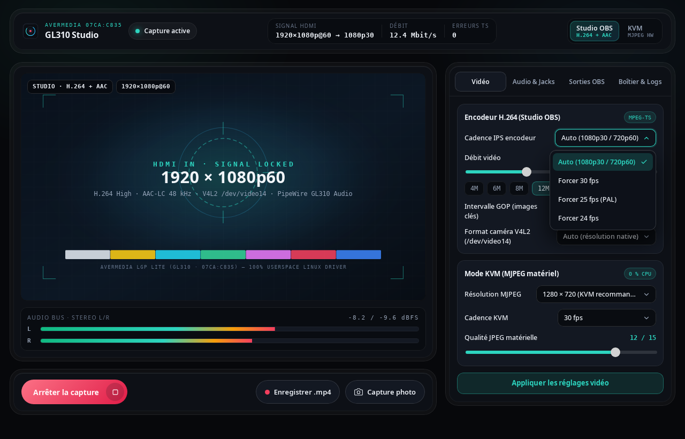
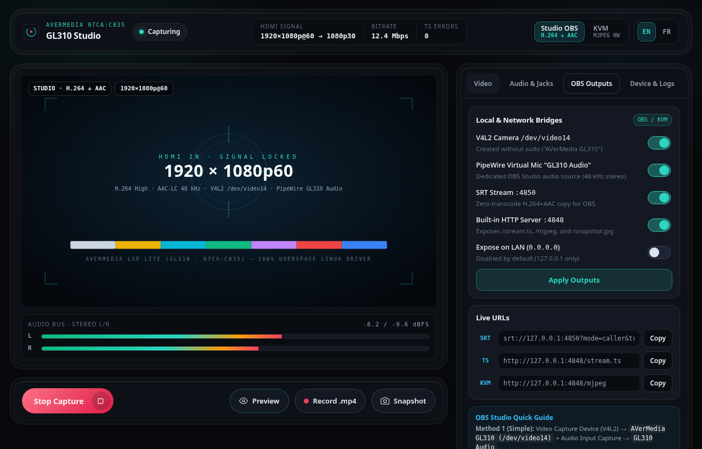
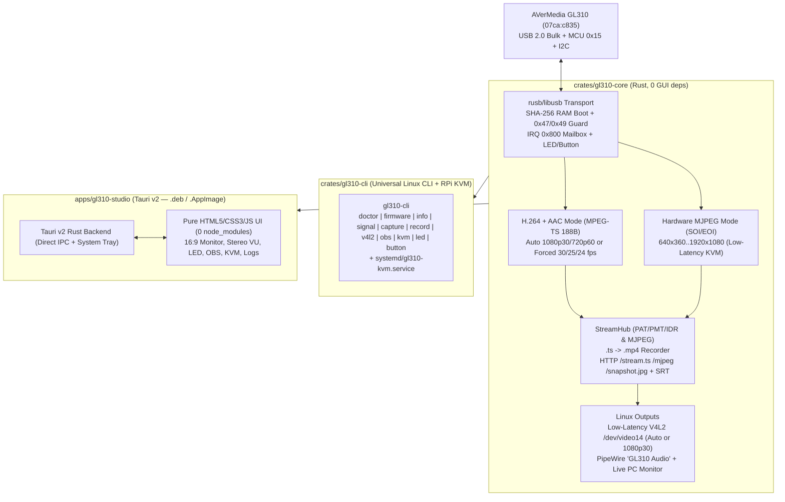

<div align="center">

# GL310-Linux

**100% Userspace Linux Driver, Universal CLI, Raspberry Pi KVM Daemon & Tauri v2 Broadcast Studio for the AVerMedia Live Gamer Portable Lite (GL310, USB `07ca:c835`)**

🇬🇧 **English** | [🇫🇷 Français](README.fr.md)

[](LICENSE)
[](Cargo.toml)
[-f43f5e.svg)](apps/gl310-studio)
[-10b981.svg)](#raspberry-pi-kvm-mode)
[%20%7C%20Fran%C3%A7ais-0ea5e9.svg)](#overview)
[-6366f1.svg)](https://github.com/valoche-68/GL310-Linux/releases/latest)

</div>

---

## Screenshots

<p align="center">
  
</p>
<p align="center">
  <em>GL310 Studio — Live 16:9 monitor, real-time stereo L/R VU meter, HDMI telemetry, and custom dark encoder controls</em>
</p>

<p align="center">
  
</p>
<p align="center">
  <em>OBS Studio &amp; Network Outputs — V4L2 <code>/dev/video14</code>, PipeWire <code>GL310 Audio</code>, SRT <code>:4850</code>, HTTP <code>:4848</code>, and copyable live URLs</em>
</p>

---

## Overview

**GL310-Linux** brings complete, zero-kernel-module support for the **AVerMedia LGP Lite (GL310 / C835, USB `07ca:c835`)** to modern Linux desktops, headless servers, and Raspberry Pi boards — built from a single unified Rust Cargo workspace:

1. **`gl310-core`** *(zero GUI dependencies)* — Complete userspace USB driver (`rusb`/`libusb-1.0`) supporting both hardware capture modes of the GL310:
   - **H.264 + AAC (MPEG-TS)** — Hardware encoding (**Auto 1080p30 / 720p60** or **forced 30/25/24 fps**) with low-latency single-slice passthrough decoding for **OBS Studio**, live preview, SRT/HTTP streaming, and lossless `.ts -> .mp4 (+faststart)` recording.
   - **Native Hardware MJPEG** — Direct hardware JPEG frames (`640×360` to `1920×1080`, 15/30 fps, quality `0–15`) with **zero CPU decoding** and low latency for **Raspberry Pi KVM / PiKVM / uStreamer** (HTTP `/mjpeg` + native zero-`ffmpeg` V4L2 `ioctl`).
   - **Full Audio & Jack Routing** — Hardware switching between **HDMI IN** (`MCU 0x2E = 0x04`) and **3.5 mm Jack AUDIO IN** (`MCU 0x2E = 0x05`), analog line-in gain (`MCU 0x41`, `1–11`), encoder digital gain (`0–15`), **3.5 mm AUDIO OUT** passthrough (`aou_pass_en`), virtual PipeWire microphone **`GL310 Audio`**, and live **PC speaker monitoring**.
   - **Hardware Safety & Recovery** — Volatile RAM firmware boot only (unplugging 10 s resets the board), mailbox liveness check on wake/resume, automatic encoder cleanup on restart, and hardcoded refusal of permanent MCU profile registers `0x47` / `0x49`.
2. **`gl310-cli`** *(zero GUI dependencies, `x86_64` & `aarch64`/`armv7`)* — Classic universal Linux command-line utility (`doctor`, `firmware`, `info`, `signal`, `dry-test`, `led`, `button`, `capture`, `record`, `v4l2`, `obs`, `kvm`, `completions`) + ready-to-use `systemd/gl310-kvm.service`.
3. **`gl310-studio`** *(Tauri v2 multi-Linux desktop app)* — Modern dark broadcast console written in **pure HTML5 / CSS3 / ES JS (zero `node_modules`)**, featuring:
   - **Bilingual English & French UI (`EN / FR`)** — English by default, with an instant **`EN / FR`** switcher right in the top bar that also translates the Linux system tray menu live (persisted across restarts).
   - **Live Preview ON/OFF toggle & automatic tray pause** — Disable the Studio preview with one click (or minimize/close to the system tray) to stop H.264 → MJPEG preview decoding and save CPU without interrupting OBS (`/dev/video14`, `GL310 Audio`, SRT, HTTP) or active `.mp4` recordings.
   - **System tray, Wayland/WebKitGTK optimization & packaging** — Close-to-tray background operation, custom in-DOM dark dropdowns, ~0% idle WebKit CPU usage, persistent logs (`~/.local/state/gl310-linux/studio.log`), and local **`.deb`** + **`.AppImage`** builds.



---

## Feature Comparison

| Feature | **GL310-Linux (This Project)** | `Fenysk/capture-consoles-salon` | `AlexXanderGrib/lgp-lite-linux-driver` | `schineaj23/gl310` |
|---|---|---|---|---|
| **Driver Architecture** | 100% Userspace Rust (`libusb`) — no DKMS / kernel rebuild | Userspace Rust (`libusb`) | Out-of-tree Linux kernel module (MJPEG) + Python CLI (H.264) | Research / reversing tools |
| **Linux Desktop GUI** | ✅ Yes (Tauri v2 — `.deb` & `.AppImage`, **EN / FR bilingual**, live preview toggle, system tray) | ✅ Yes (`egui` desktop GUI) | ❌ No | ❌ No (macOS app only) |
| **Universal Linux CLI & Raspberry Pi KVM (Hardware MJPEG + `systemd`)** | ✅ Yes (`gl310-cli` + `systemd/gl310-kvm.service`, 0 GUI deps) | ❌ No | ⚠️ Partial (MJPEG via kernel module only) | ❌ No |
| **H.264 + AAC Capture (OBS & `.mp4`)** | ✅ Yes (Auto 1080p30/720p60 + forced 30/25/24 fps) | ✅ Yes | ✅ Yes (Python script) | ⚠️ Video only (no audio) |
| **Hardware MJPEG Mode (Zero-CPU KVM)** | ✅ Yes (640×360..1920×1080, HTTP `/mjpeg` + native zero-`ffmpeg` V4L2 MJPEG `ioctl`) | ❌ No | ✅ Yes (kernel module) | ❌ No |
| **HDMI + VESA BIOS Resolution Table** | ✅ Full 49-entry IT6604 table (640×480..1080p60) | `1080p30` fixed | 1080p / 720p | Research |
| **3.5 mm Jack AUDIO IN & Analog Gain** | ✅ Yes (`MCU 0x2E=0x05` + `MCU 0x41` gain `1–11`) | ❌ HDMI audio only | ❌ No | Research |
| **3.5 mm Jack AUDIO OUT & PC Monitoring** | ✅ Yes (`aou_pass_en` + live PipeWire PC monitor + VU meter) | ✅ `aou_pass_en` | ❌ No | ❌ No |
| **V4L2 `/dev/video14` + PipeWire `GL310 Audio` + SRT + HTTP** | ✅ All built-in (low-latency V4L2 Auto or Fixed 1080p30) | PipeWire cam (GStreamer) + PipeWire audio + SRT + HTTP (no V4L2 `/dev/video*`) | V4L2 MJPEG only | ❌ No |
| **LED Ring & Physical Button Control** | ✅ Full LED modes + programmable button action (`--exec` / GUI) | ✅ Basic | ✅ Button input device | Research |
| **Hard Safety Guard (`0x47`/`0x49` Blocked)** | ✅ Hardcoded in low-level transport | ✅ Yes | ✅ Yes | — |
| **License** | MIT | MIT | GPL-2.0 | Unspecified |

---

## Download & Quick Installation

### Option 1 — Prebuilt Release Packages (Zero Proprietary Firmware Included)

Download the latest release from **[GitHub Releases](https://github.com/valoche-68/GL310-Linux/releases/latest)** and verify `SHA256SUMS.txt`:

- **Debian / Ubuntu / Mint (`.deb`, amd64)** — installs `gl310-cli`, `gl310-studio`, desktop icon, `udev` rule, and `systemd` KVM unit:
  ```bash
  sudo apt install ./gl310-linux_0.2.0_amd64.deb
  ```
- **Any Linux x86_64 (`.AppImage`)** — portable GUI + bundled CLI (`--cli`):
  ```bash
  chmod +x GL310-Studio-0.2.0-x86_64.AppImage
  ./GL310-Studio-0.2.0-x86_64.AppImage           # Launch GL310 Studio
  ./GL310-Studio-0.2.0-x86_64.AppImage --cli doctor
  ```
  *(For non-root USB access with the AppImage, install `udev/70-avermedia-gl310.rules` via `sudo bash scripts/install_udev.sh`.)*
- **Standalone CLI (`gl310-cli-v0.2.0-linux-x86_64.tar.gz`)** — zero GUI dependencies.

> **Binary compatibility note:** The `v0.2.0` prebuilt `x86_64` packages were built locally on **Debian 13 (`glibc 2.41`, `libwebkit2gtk-4.1`)**. They run out-of-the-box on Debian 13+, Ubuntu 25.04+, Arch Linux, and recent Fedora releases. On older distributions (Debian 12, Ubuntu 22.04/24.04) or **Raspberry Pi (`aarch64` / `armv7`)**, build natively in one step with `./install.sh` below.

### Option 2 — Build & Install from Source on Any Linux Distro (`./install.sh`)

```bash
# Prerequisites on Debian / Ubuntu (CLI only needs libusb-1.0-0-dev + ffmpeg):
sudo apt install libusb-1.0-0-dev pkg-config ffmpeg v4l2loopback-utils pipewire-bin pulseaudio-utils

# Additional build dependencies for GL310 Studio (Tauri v2):
sudo apt install libwebkit2gtk-4.1-dev libgtk-3-dev libsoup-3.0-dev libssl-dev libayatana-appindicator3-dev

# Desktop Studio (gl310-cli + gl310-studio Tauri v2 + desktop launcher + udev):
./install.sh --studio

# Headless / Minimal Linux CLI only (zero GUI dependencies):
./install.sh --cli-only

# Raspberry Pi / Server KVM daemon (gl310-cli + systemd gl310-kvm.service + udev):
./install.sh --kvm

# Build local .deb, .AppImage, CLI tarball, and SHA256SUMS.txt yourself:
./scripts/build_release_local.sh
```

> **Wayland + NVIDIA Note:** Launch GL310 Studio via the desktop shortcut `GL310 Studio`, `./scripts/run-studio.sh`, or the `.AppImage`. Modern NVIDIA (`≥ 555`) + WebKitGTK (`≥ 2.46`) run natively with hardware DMABUF acceleration (~0% idle WebKit CPU). On legacy NVIDIA drivers (`< 555`), the launcher automatically enables `WEBKIT_DISABLE_DMABUF_RENDERER=1` (you can also force software fallback anytime with `GL310_SOFTWARE_RENDER=1`).

---

## Firmware Integration Guide

The GL310 requires two proprietary AVerMedia firmware files (`qpvidfwusb.bin` and `qpaudfwusb.bin`) to be uploaded into its **volatile ARM RAM** on every power-up. **These binaries are copyrighted by AVerMedia Technologies, Inc. and are NEVER included in this repository or in any `.deb` / `.AppImage` release package.**

Every upload enforces strict SHA-256 verification before touching USB:
- `qpvidfwusb.bin` (`454,064` bytes): `8da30f6dc2d4fee5aeb3e2e06df5581db4c01d146c50c21f6a5d4824025a47d1`
- `qpaudfwusb.bin` (`363,832` bytes): `0e8ea66b6a3ddb68f9a283f10155df90ce8d6f46599ed0ecf6f308d6c90210f4`

### Method 1 — 1-Click Automatic Audited Download (Recommended)

Downloads the archived official WHQL-signed AVerMedia `v3.2802.64.40` driver archive from Archive.org, verifies its SHA-256 & MD5 (`6aa363d7d7458dd08f021277353d6f2f`), extracts only the two `.bin` files in memory (**zero Windows binary execution**), verifies both SHA-256 digests, and installs them into `~/.local/share/gl310-linux/firmware/`:

```bash
# Via the CLI (or click "Download (Audited Archive.org)" inside GL310 Studio -> Device & Logs):
gl310-cli firmware fetch

# Or via the standalone shell audit script (also inspects the WHQL Authenticode signature via OpenSSL):
./scripts/fetch_and_audit_firmware.sh
```

### Method 2 — Manual Import from an Existing Windows Driver or ZIP

If you already own the official AVerMedia driver `.zip` or Windows installation (`3.7.x.39` or `3.2802.x.40`):

```bash
# Import from a local ZIP archive (read safely in-memory, never executed):
gl310-cli firmware import /path/to/GL310_driver.zip

# Or import from a local Windows driver directory:
gl310-cli firmware import "/mnt/windows/Program Files (x86)/AVerMedia"

# Or point directly to any directory containing both .bin files:
export GL310_FIRMWARE=/path/to/my/firmware_dir
gl310-cli firmware verify
```

Default firmware search order: `--firmware <DIR>` → `$GL310_FIRMWARE` → `./firmware/` → `~/.local/share/gl310-linux/firmware/` → `/usr/share/gl310-linux/firmware/` → `/lib/firmware/avermedia/`.

---

## Classic Universal Linux CLI Usage

```bash
# 1. Check USB, udev, firmware SHA-256, v4l2loopback, ffmpeg, and PipeWire:
gl310-cli doctor

# 2. Hardware Phase 1 dry-test (no HDMI cable required):
gl310-cli dry-test

# 3. Inspect live HDMI video & audio signal:
gl310-cli info
gl310-cli signal --watch

# 4. Stream raw H.264+AAC MPEG-TS to stdout (pipe into ffplay, mpv, or VLC):
gl310-cli capture --bitrate 12000 --audio-in hdmi | ffplay -fflags nobuffer -

# 5. Record directly to .mp4 (lossless +faststart remux on Ctrl+C):
gl310-cli record gameplay.mp4 --fps 30 --bitrate 12000 --audio-in jack --analog-vol 9

# 6. Expose GL310 as a standard V4L2 camera (/dev/video14) on any Linux distro:
gl310-cli v4l2 --device /dev/video14 --force-1080p30

# 7. Launch full headless OBS Studio bridge (V4L2 + PipeWire + SRT + HTTP):
gl310-cli obs --force-1080p30 --bitrate 12000

# 8. Control the LED ring or trigger custom shell scripts from the physical button:
gl310-cli led clockwise
gl310-cli button --exec 'notify-send "GL310" "Button pressed!"'

# 9. Shell completions (bash / zsh / fish):
gl310-cli completions bash > ~/.local/share/bash-completion/completions/gl310-cli
```

---

## OBS Studio Guide & Latency Notes

1. Start **GL310 Studio** (or `gl310-cli obs`) and click **Start Capture** *(you can close the window to keep it running quietly in the system tray)*.
2. **Method A — V4L2 + PipeWire (Easiest, works in OBS, Discord, VLC, Zoom):**
   - Add **Video Capture Device (V4L2)** → select **`AVerMedia GL310 (/dev/video14)`** (use *Force 1080p 30 fps fixed* for invariant OBS scene geometry).
   - Add **Audio Input Capture (PulseAudio / PipeWire)** → select **`GL310 Audio`**.
3. **Method B — Direct SRT / HTTP Media Source (Zero CPU Video Decoding):**
   - Add **Media Source** → uncheck *Local File*.
   - Input: `srt://127.0.0.1:4850?mode=caller&transtype=live&latency=120000` (or `http://127.0.0.1:4848/stream.ts`).
   - FFmpeg Options: `probesize=500000 analyzeduration=500000`.

> **Hardware Latency Note:** Because the GL310 is a **USB 2.0 hardware H.264 encoder**, H.264+AAC capture has an inherent hardware encoding latency of ~250–400 ms (just like RECentral on Windows). Always use the box's **zero-latency hardware HDMI OUT passthrough** to play on a TV/monitor. For minimal USB preview latency (BIOS/KVM without audio), switch to **KVM (Hardware MJPEG)** mode; for faster OBS lock in H.264 mode, set **GOP Interval** to **1 second**.

> **Audio & Diagnostics:** If your console outputs Dolby Digital / DTS bitstream audio, switch it to **Uncompressed Stereo LPCM** so the GL310 captures audio cleanly. Persistent logs (including USB/HDMI/HDCP events and `ffmpeg` diagnostics) are written to `~/.local/state/gl310-linux/studio.log` and visible live in **GL310 Studio → Device & Logs**.

---

## Raspberry Pi KVM Mode

`gl310-cli` compiles cleanly for `aarch64` / `armv7` with **zero GUI dependencies** and drives the GL310's **native hardware MJPEG encoder**, eliminating CPU transcoding on Raspberry Pi Zero 2 W / Pi 3 / Pi 4 / Pi 5:

```bash
# Serve built-in KVM web viewer (/), /mjpeg, and /snapshot.jpg with ZERO ffmpeg CPU decode:
gl310-cli kvm --res 720p --fps 30 --quality 12 --http 0.0.0.0:4848

# Optional: also feed /dev/video14 via native zero-ffmpeg V4L2 MJPEG (ioctl) for PiKVM / uStreamer:
gl310-cli kvm --res 720p --fps 30 --quality 12 --http 0.0.0.0:4848 --v4l2 /dev/video14
```

To run persistently on boot (`./install.sh --kvm` automatically installs verified firmwares from `./firmware/` or `~/.local/share/gl310-linux/firmware/` into `/lib/firmware/avermedia/`):
```bash
gl310-cli firmware fetch
./install.sh --kvm
sudo systemctl enable --now gl310-kvm.service
```

> **BIOS / UEFI Compatibility Note:** Static analysis of the official `getHdmiVideo_6604` timing table confirms 49 progressive CEA (`1080p`, `720p`, `480p`, `576p`) and PC/VESA modes (`640×480@60`, `800×600@60`, `1024×768@60`, `1280×768@60`, `1280×800@60`, `1280×1024@60`, `1360×768@60`, `1440×900@60`, `1680×1050@60`) with automatic encoder reconfiguration across BIOS → OS resolution changes.

---

## Credits & Acknowledgments

This clean-room MIT project builds upon the open hardware interoperability findings pioneered by the Linux community:

- **[`Fenysk/capture-consoles-salon`](https://github.com/Fenysk/capture-consoles-salon)** *(MIT)* — Pioneering userspace Rust GL310 boot sequence, MPEG-TS capture protocol, and Studio workflow inspiration.
- **[`AlexXanderGrib/lgp-lite-linux-driver`](https://github.com/AlexXanderGrib/lgp-lite-linux-driver)** *(GPL-2.0)* — Hardware MJPEG mode research, IRQ-gated mailbox insights, and GL310 Linux ecosystem contributions.
- **[`schineaj23/gl310`](https://github.com/schineaj23/gl310)** — Early GL310 / C835 reverse-engineering groundwork.
- **[`Trouffman/octv_gears_lgp`](https://github.com/Trouffman/octv_gears_lgp)** & **[`FireCulex/avermedia-c985-linux`](https://github.com/FireCulex/avermedia-c985-linux)** — QL202 / QPSOS mailbox, NUC100 MCU, and AVerMedia chipset documentation.

---

## Legal & Hardware Safety Notice

- **GL310-Linux** is an independent open-source project under the **MIT License** and is **not affiliated with, endorsed by, or supported by AVerMedia Technologies, Inc.**
- No proprietary AVerMedia binaries, firmwares, or Windows drivers are distributed in this repository or in release packages (verified before every commit/release by `scripts/check_repo_clean.sh`).
- **Volatile RAM only:** Firmwares are uploaded strictly to RAM; unplugging the device for 10 seconds restores factory state. Writes to non-volatile MCU profile registers `0x47` and `0x49` are unconditionally refused by `gl310-core`.
